+++
date = '2026-09-11T08:20:32Z'
draft = false
title = "Week 33 - Grand Swiss Adventure Part 2"
description = "Descending from the Alps, a swim in a glacier lake, a five course meal at a vegetarian restaurant and a solar eclipse."
image = 'cover.jpg'
+++

# Week Thirty-three: Sunday August 9th - Saturday August 15th

* **Aug 9th**: Mushroom ravioli and Caprese salad
* **Aug 10th**: Mushroom stroganoff and rosti
* **Aug 11th**: Five-course vegetarian meal
* **Aug 12th**: cheese bagel
* **Aug 13th**: Broccoli and peanut butter noodles
* **Aug 14th**: Leftover noodles
* **Aug 15th**: Poke bowl

# August 9th: Mushroom ravioli and Caprese salad

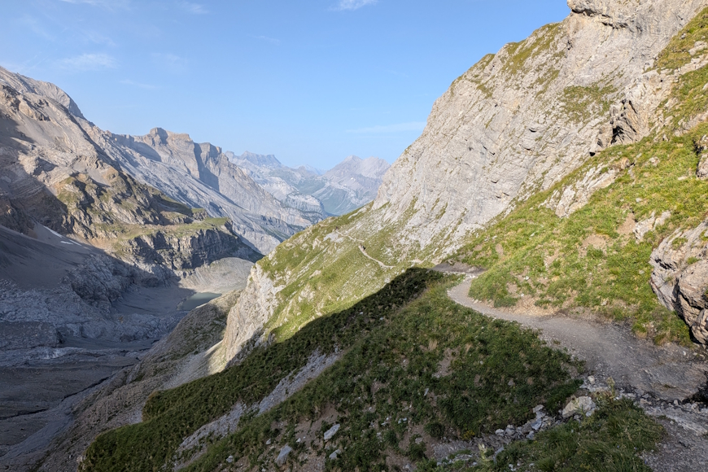

We left Bluemlisalphütte bright and early and made our way down towards Kandersteg, with the route taking us past a lovely glacier lake called Oeschinensee. I know some people prefer walking up to down, but after the high mountain huts and long climbs of the previous few days, it was a relief to be heading downhill into the valley.

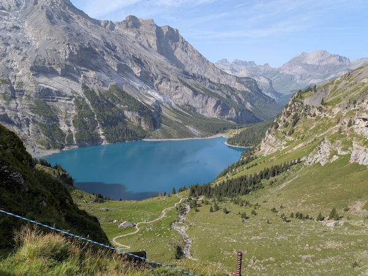

It was quite a shock to finally come back down into civilisation once we reached Oeschinensee. It's much more touristy, and there's a sudden shift as we transition from sunburnt backpackers in Mammut to very well put together tourists in lululemon leggings and designer sunglasses. Funny how you can suddenly become very self concious.

Had a disappointing lunch in a restaurant by the lake, mostly so we could just get out of the sun into some shade. Mum and I split a veggie burger and a rosti, both were probably just microwaved.

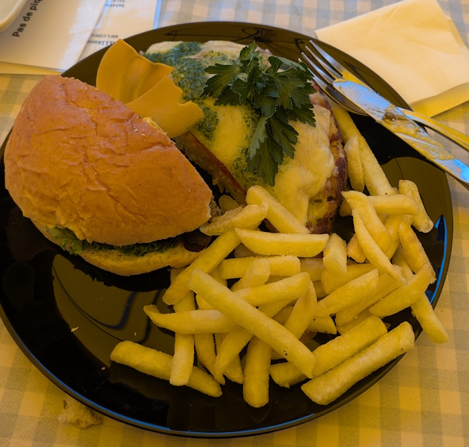

After that, it's only a short walk down the rest of the way into Kandersteg itself. It's funny, the place has barely changed from when we went with the scouts as children. A place frozen in time. 

That evening we found a small restaurant for dinner and I went for a Caprese salad and mushroom ravioli. It was a fairly simple meal, but tasty.

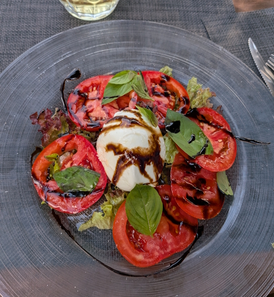
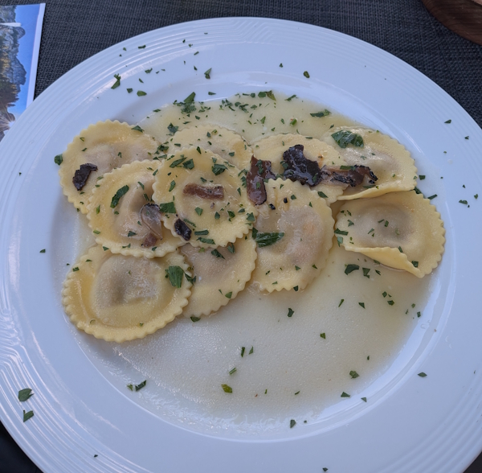

# August 10th: Mushroom stroganoff and rosti

We got up early in the morning on the Monday and headed back to Oeschinensee for a quick dip in the lake before the crowds arrived. Honestly one of the most beautiful places on earth, I've said it a lot before but you just can't capture it in photos. before we headed back down we had a quick stop for a cup of coffee and a strudel to admire the view.

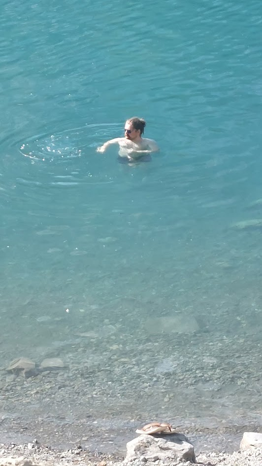
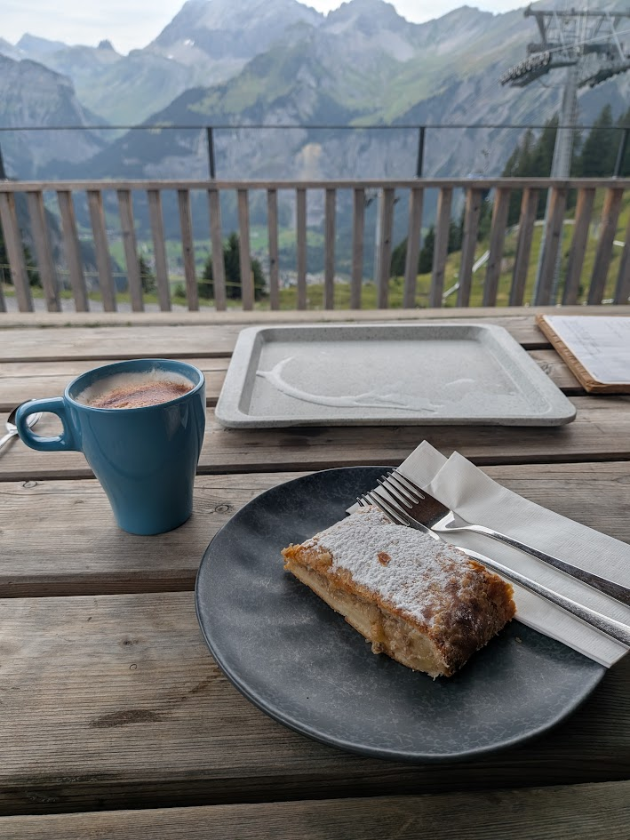

After that we had a wander down the valley for a while. Kandersteg isn't a busy place, but as you head down it get's even quieter. Just farmhouses, and occasional bits of industry. Also at one point we spotted what a weed farm, which was an unexpected sight in the middle of the Swiss countryside. No idea on the legality, it was just out in the open.

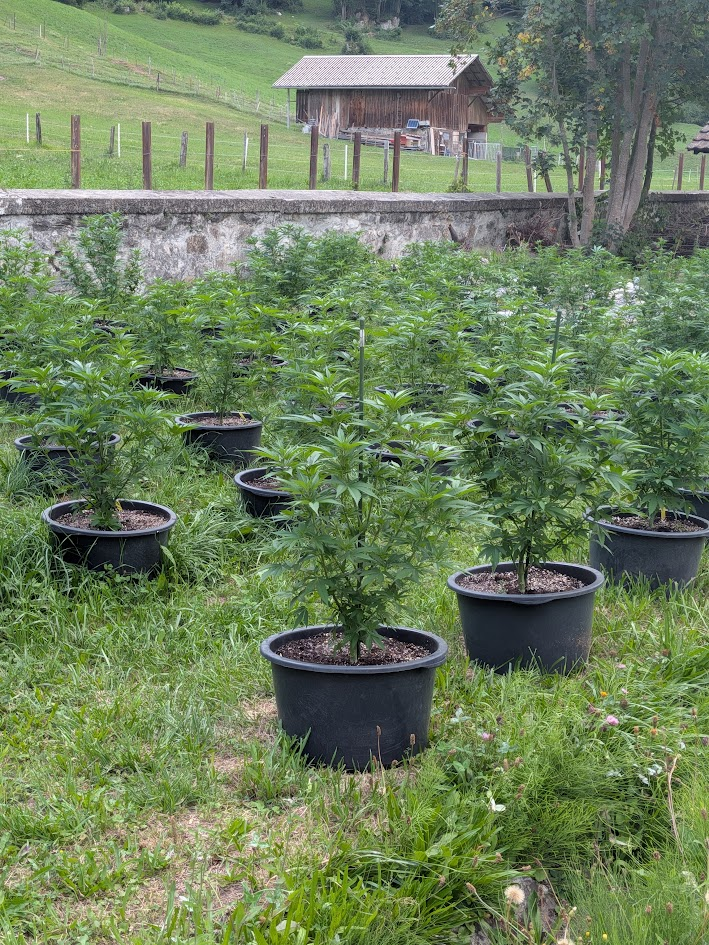

Dinner was at a hotel restaurant. there was a funny bit of drama as the waiter/owner seemed determined to turn away anyone who tried to come, in while the waitress kept letting people through the door. The food itself was hearty, I had a mushroom stroganoff with rosti. Much higher quality than the one I had yesterday for lunch. Another caprese salad for starter as well, although this one was served with strawberry instead of basil.

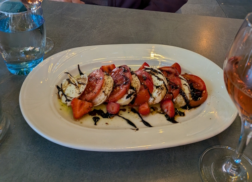

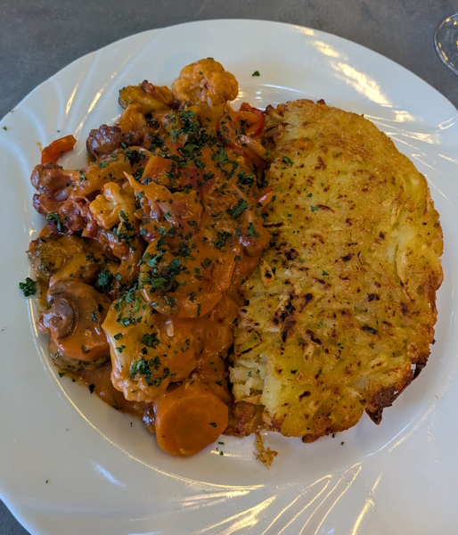

I'm not usually one for tradition, but last time I was here with Rick I made a habit of ordering a Coupe Colonel when having a meal out in Kandersteg. It's a scoop of lemon sorbet with a shot of vodka. Something about the sharp tastes of the lemon and vodka, and the sweetness from the sorbet works so well together. Unfortunately, the restaurant forgot our dessert order (I think the owner was turning people away due to lack of staff), so we ended up waiting around for an hour before it finally arrived.

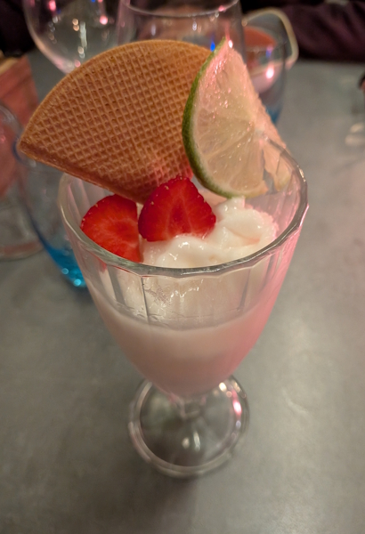

Still, I didn't ming the wait and a good way to finish our last full day in Kandersteg.

# August 11th: Five-course vegetarian meal

Tuesday was our final day of walking, and it took us up and over the Gemmi mountain pass and down towards Leukerbad. At this point, even with a day of light walking yesterday, were knackered. There was an option to walk up, but we took a cable car up to the top of Gemmi pass, which is a hanging valley jutting out above kandersteg.

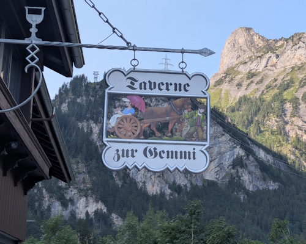

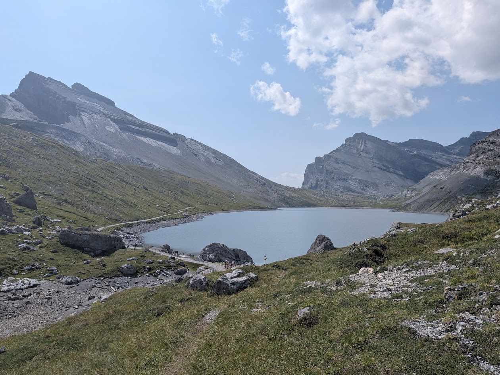

It's reasonably flat along the pass, but still quite a long walk. Busier as well than our other legs, I presume because it's more accessible. Various families out walking with their dogs, on round walks. At least, it's an easy walk until you get to the end of the valley.

At this point there's a decision. Either take another cable car down, or walk along a narrow path that hugs the cliff face. It's a descent of around 1,000 metres, with some pretty sheer drops off the edge. We'd taken the cable car up so honor demanded we walk down.

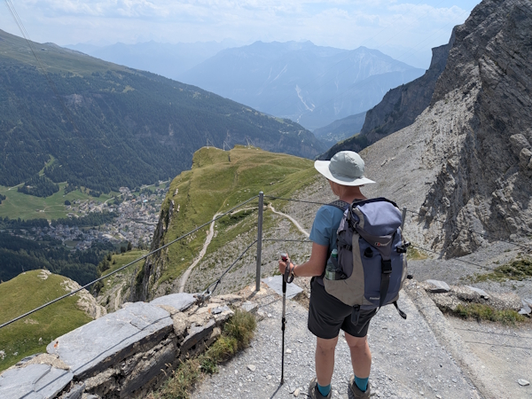

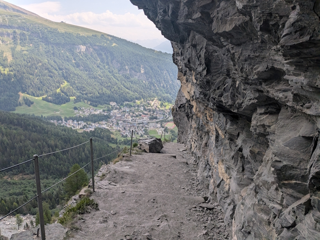

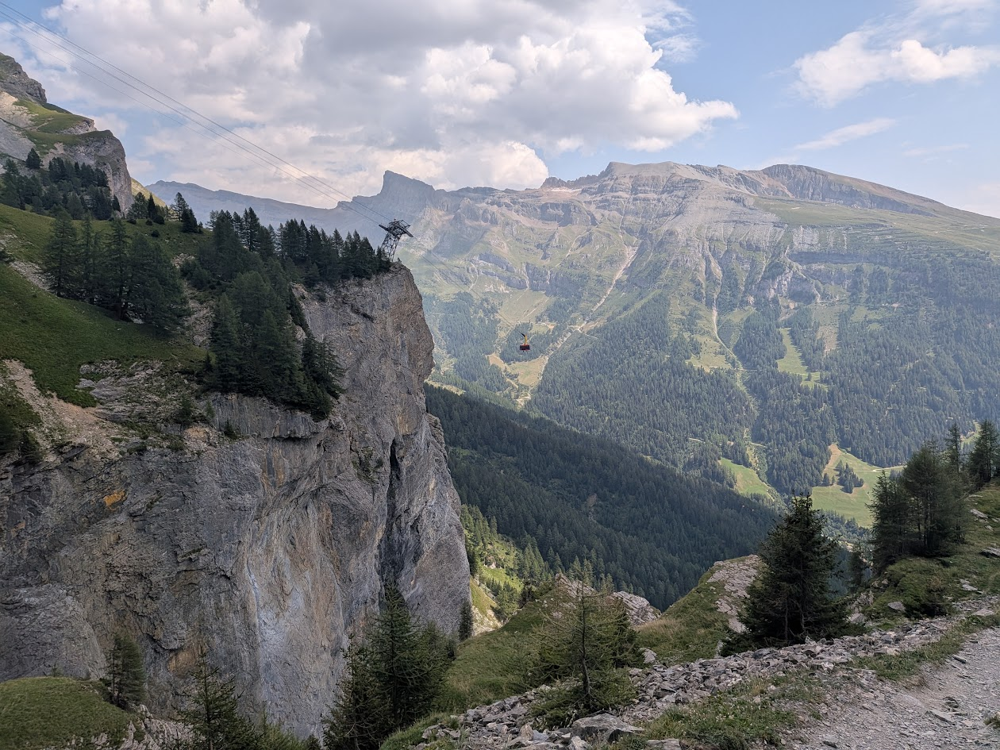

About halfway down it started spotting with rain, which lit a bit of a fire under us. It was a race down the cliff to get to the bottom before the rain started making the path slick and treacherous. Exciting stuff.

Obviously, we survived, and made it down into Leukerbad exhausted and only a little soggy. To celebrate we found a cafe which was still open and had a couple of slices of their last (boozy) cake.

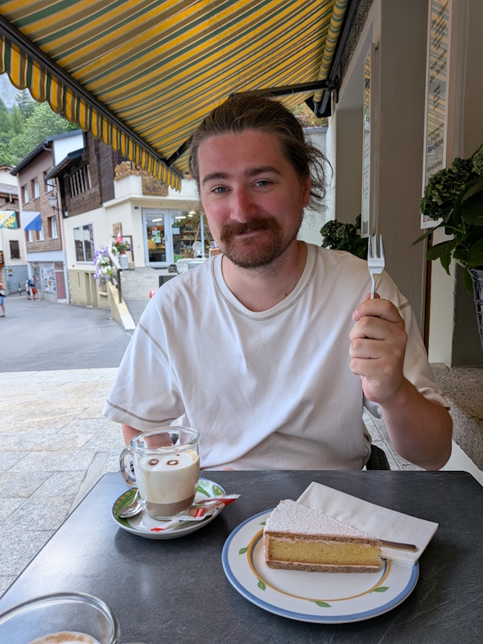

After the cake we checked into our final hotel and enjoyed a bit of luxury. The room was at the top of a hotel and had great view out across Leukerbad towards Gemmi pass.

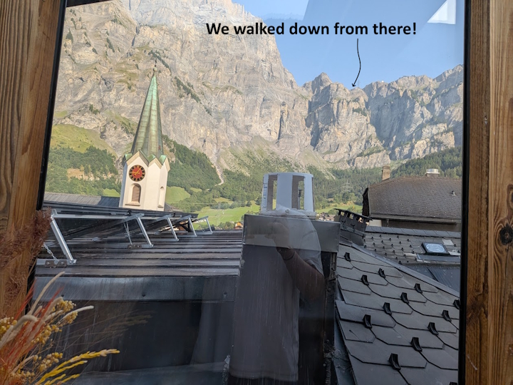

Although we'd finished out hiking, there was one last meal to look forward to. That evening we went to 51°, a vegetarian restaurant in Leukerbad, for a fancy five-course set menu. A very lovely change of pace after having to pick the one or two veggie options on most of the Swiss menus.

Starter was bread with three dips, from memory I believe a whipped herb butter, a mushroom pate and a curry leaf infused oil. The curry oil was the stand out, absolutely packed with flavour, and they'd left course salt in there as well. After that was a soup course, although I'll be honest I've completely forgotten what was in it.

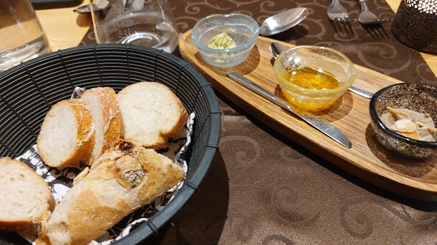
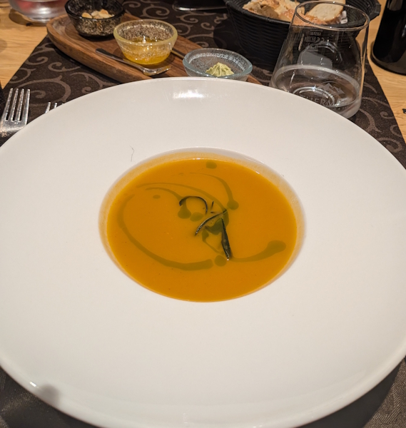

Third course was a plate from the salad buffet. Tried not to pig out too much, always dangerous giving me all you can eat options.

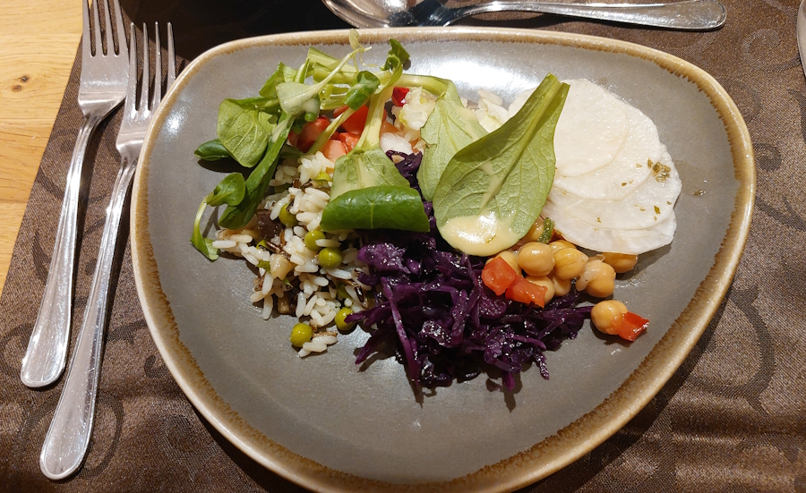

Main was a grilled cauliflower dish, although again I've forgotten the specifics. From the image looks like a puree, with a herby pesto, some kind of foam, pomegranates. All very chefy.

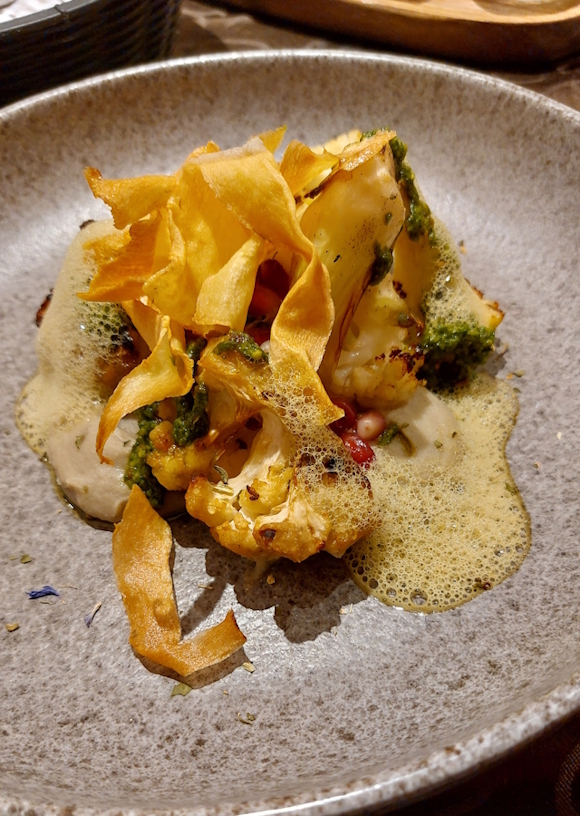

And for desert, the classic Crème brûlée, this one had grapefruit, the acidity helped balance out the richness of the custard.

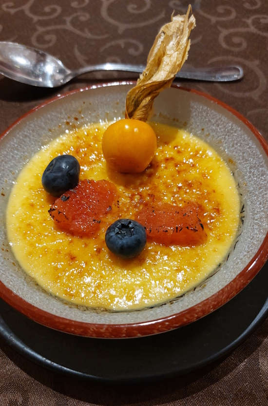

# August 12th: Cheese bagel

The next day was mostly spent travelling. We got a bus down from Leukerbad, then a train all the way to Geneva, and eventually after inevitable delays a plane back home. By the time we reached the airport the options for food were limited, so I picked a cheese bagel from a store in the terminal.

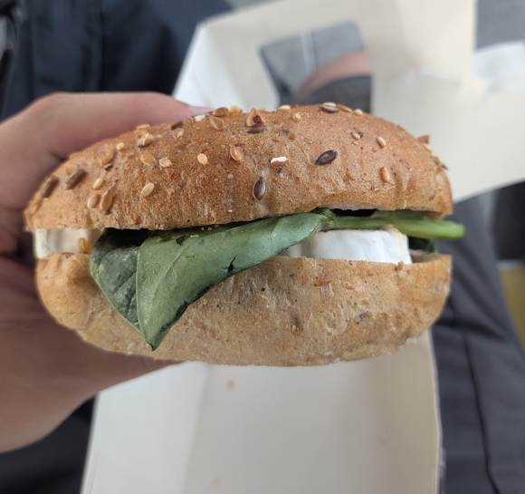

By fluke of timing, the taxi back to my house in Chorlton arrived 5 minutes before the start of the solar eclipse, so I wandered over to the park to join a couple of friends and borrow their glasses.

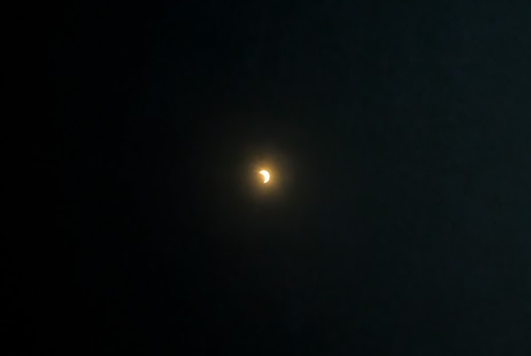

# August 13th: Broccoli, tofu and peanut butter noodles

I was keen to restock my protein levels after a week of mountaineering. I improvised a bowl of noodles with broccoli, some scrambled fried tofu, and a peanut butter, soy, sugar and sesame oil sauce. Very quick to whip together but a bit of greenery in there so it's at least a little healthy.

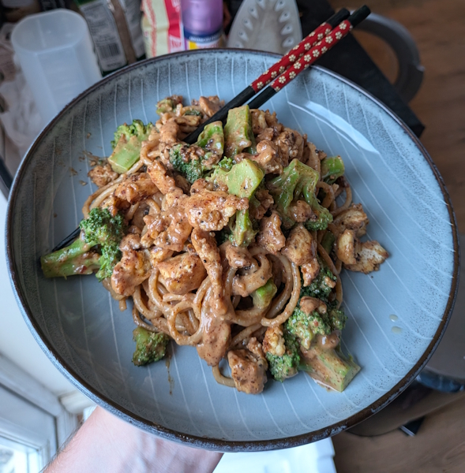

# August 15th: Poke bowl

I felt like having something fresh, so I ordered a poke bowl. After all the cheese, potatoes, pasta of the trip, the bright vegetables made for a welcome change.

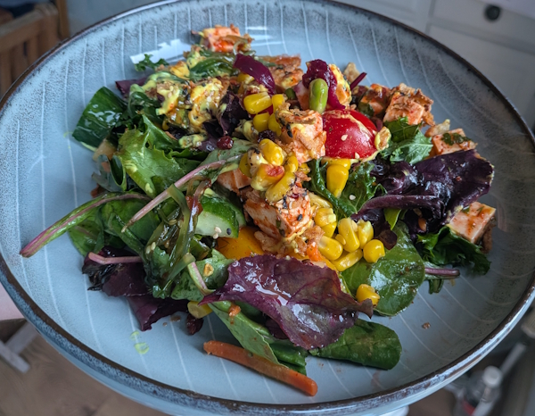