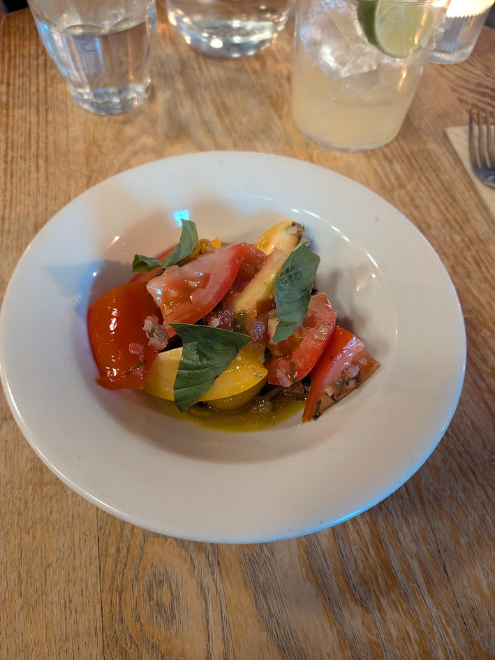
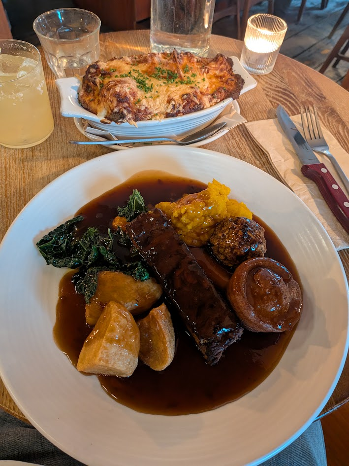
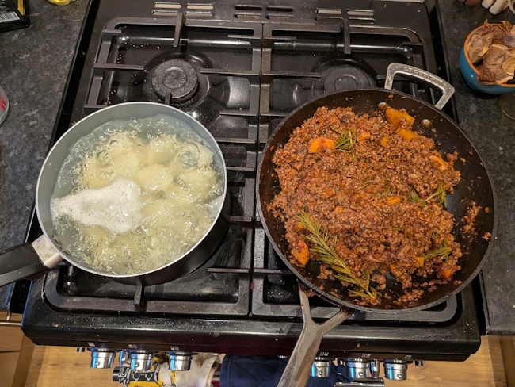
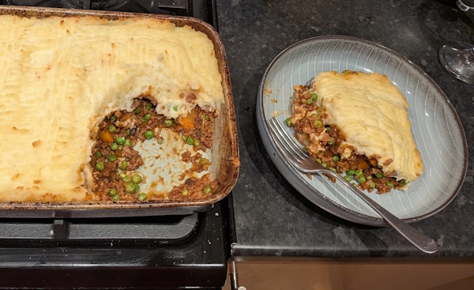
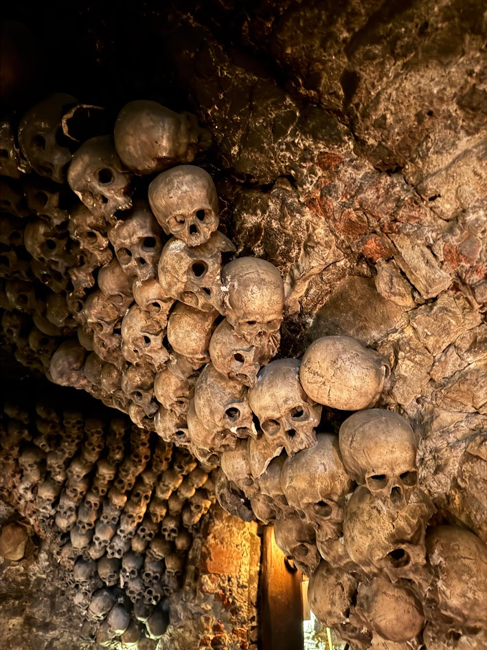
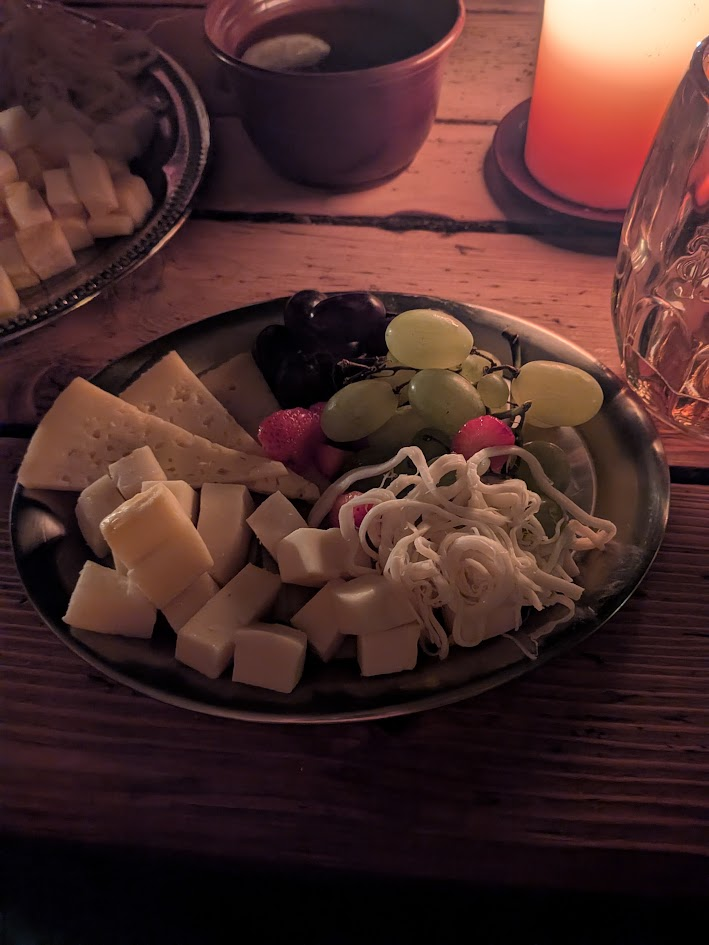
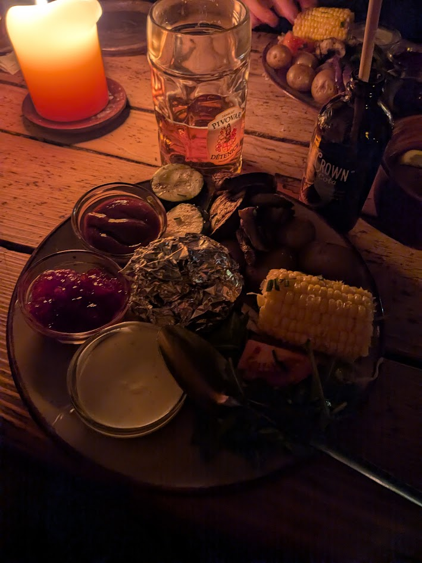
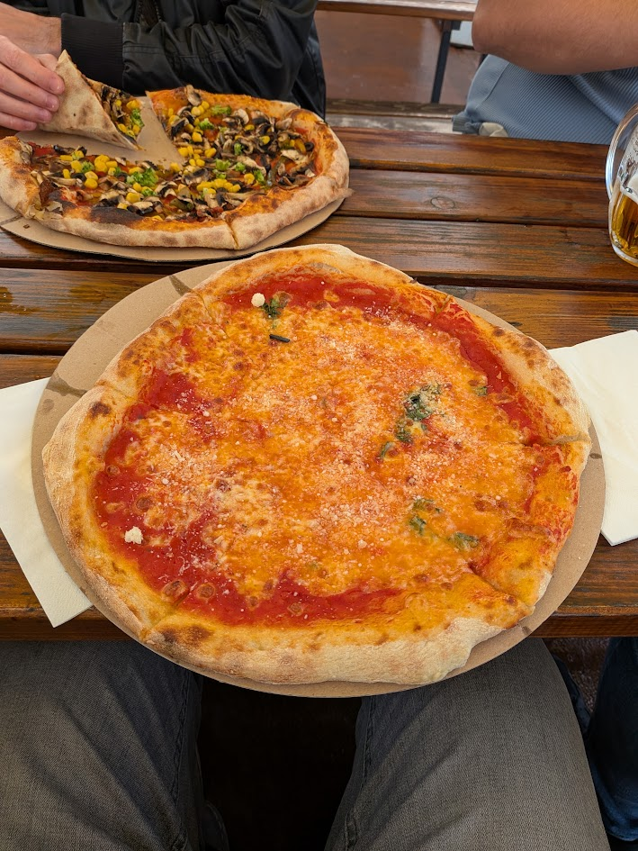

+++
date = '2026-09-27T20:00:31Z'
draft = false
title = "Week 34 - I'm a fire starter, twisted fire starter"
description = "A roast dinner at the Jane Eyre, I make shepherds pie for the first time in a long while, and a trip to Prague."
image = 'cover.jpg'
+++

# Week Thirty-four: Sunday August 16th - Saturday August 22nd

* **Aug 16th**: Veggie roast dinner at the Jane Eyre
* **Aug 17th**: Leftover broccoli noodles
* **Aug 18th**: Veggie shepherds pie
* **Aug 19th**: Leftover shepherds
* **Aug 20th**: Leftover shepherds  
* **Aug 21st**: 'Medieval' banquet
* **Aug 22nd**: Pizza

I'm getting very behind on these now, partially due to being away a lot of weekends and also partly because I'm out of the habit. I'm going to try and release one a day to catch up, however the entries may be a bit less detailed as a result. Also, This one is from two months ago anyway so there's only so much I can remember.

# August 16th: Veggie roast dinner at the Jane Eyre

Katie had shown me an app called EatClub which lets restaurants fill up their empty tables by giving money off the bill, so I decided to treat myself to a sunday dinner out at the Jane Eyre on Beech road.

For starter I had heritage tomatoes, with parsley and caper vinaigrette and basil.

Main course was the vegan nut roast with roast potatoes, roasted carrots, root veg mash, vegan stuffing, seasonal greens, vegan yorkie, and sunday gravy. My eyes were once again too big for my belly, so I got the cauliflower cheese as a side. Had to take a bit of it back in a doggy bag, which I take as a mark of shame.

I had a few cocktails as well, which you might be able to spot on the table, and I remember them being delicious but I can't for the life of me remember what was in them.

# August 18th: Veggie shepherds pie

I still had a load of the TVP (fake meat) left, and it's honestly just been a very long time since I've had a shepherds pie. Kind of basic but very comforting. 
For this one I made the sauce using the TVP with some veggie stock, a bit of marmite, Henderson's relish, tomato paste, along with peas, carrots and rosemary. The TVP works really well as a fake mince, and taste wise it just takes on the flavour of the stuff it's cooked in. 

This made an absolute boat load, however one of the downsides is mashed potato is one of the few things that's not as good as leftovers. I dutifully finished it all off over the next few days, but in future I'd just make enough to be eaten on the day.

# August 21st: 'Medieval' banquet

It was Chris's stag do on the weekend, over in the mecca of drunk english men: Prague.
I won't go into it too much, suffice to say there were a lot of trips to Irish bars. 

We did eat somewhere interesting on the first Friday night though. It was a place called U Krále Brabantského, aka The King of Brabant Tavern. It's a candlelit underground dungeon with vaulted stone cellars covered with plaster skulls. They had traditional musicians touring all the rooms through the night, along with jugglers, belly dancers and most excitingly fire breathers.

Food for the veggies was kind of basic, a starter of fruits and various cheeses and bread, with a main of grilled veggies and more cheese. The meat eaters looked like they had a better deal, but my heart went out to poor Milton who had the vegan option, which was the same as the veggie but without the cheese.

Can't complain too much though, the drinks were all free, and the entertainment was a proper laugh.
I managed to get a good clip of the firebreather at the climax of the show:



# August 22nd:

On the saturday we went out for a lunchtime meal on one of the boats on the river Vltava, Kept it simple and went for a margherita pizza.

The less said about the rest of the saturday the better.