+++
date = '2026-10-21T00:00:31Z'
draft = false
title = "Week 35 - Meatball Subs and a Lundy Landing"
description = "A peanut butter Viennese veggie burger, homemade meatball subs, a stop at Gloucester Services and a boat ride on the way to Lundy island."
image = 'cover.jpg'
+++

# Week Thirty-five: Sunday August 23rd - Saturday August 29th

* **Aug 23rd**: Peanut butter veggie burger
* **Aug 24th**: Tomato pasta
* **Aug 25th**: Meatball sub
* **Aug 26th**: Leftover meatball sub
* **Aug 27th**: Leftover meatballs
* **Aug 28th**: Mac and cheese at Gloucester services
* **Aug 29th**: Chilli nachos and cinnamon bun cheesecake

# August 23rd: Peanut butter veggie burger

Woke up on the sunday a little hungover, so dragged myself out of bed and went and got a very nice chocolate croissant. Truns out Vienna is a very nice city when you're actually out and about in it, and not surrounded by stag dos.

 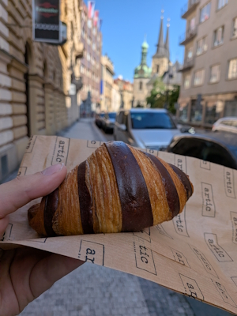

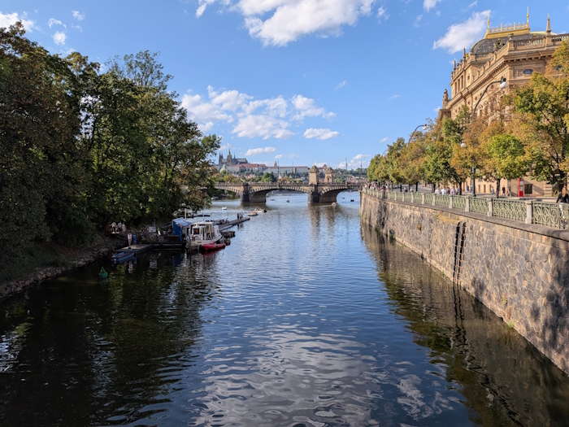

One of the guys found a burger place for lunch which did some mad combos. I went with a peanut butter veggie burger, which worked really well. Probably the best thing I ate all weekend, but so filling I couldn't face dinner that evening. Not sure if I'd have the guts to try it at home, you've got to get the balance just right, too much peanut butter and it'd turn into a clogging mess.

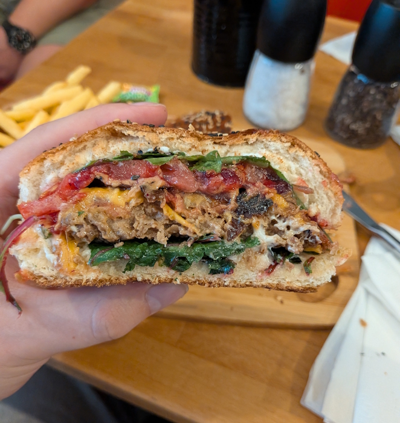

# August 24th: Tomato pasta

After flying back on the sunday I didn't have much left in the house, so opted for a pasta using leftover bits I had lying around. A tin of tomatoes, some garlic and oregano, and a splash of balsamic vinegar. Fry the garlic and oregano in a bit of oil, then add in the chopped tomatoes and leave to cook down with a pinch of salt and half a pinch of sugar. Add a little vinegar at the end. It's hardly the most exciting meal but it's incredibly easy and quick to put together. I didn't bother with a picture.

# August 25th: Meatball Sub

I don't really eat at subway anymore, but part of me still hankers for the classic from my teenage years: the footlong meatball sub on hearty italian. Biggest problem is trying to find a proper sandwich roll, soft with just the right amount of chew, sturdy enough to hold up against marinara sauce.

My quest for the sub roll will have to wait for another day though, because for this one I just bought a couple of basic rolls from tesco. Very disappointing but what can you do, I didn't have it in me to make my own bread that day.

For the meatballs I followed the same recipe I'd used previously for [my TPV burger](/posts/week-27/), but just rolled them into a ball shape instead of a patty. That basically meant you hydrate the TPV in veg stock, and some linseed in water. Then mix both together with miso paste, nutritional yeast, onion and garlic powder, mayo, blackstrap molasses, Henderson's relish, flour and breadcrumbs. A lot of those are doing similar jobs, trying to give the fake meat a deep umami flavour.

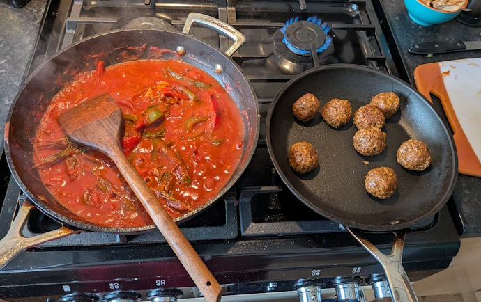

For the sauce I kept it simple. I fried some chopped up peppers and onions until soft, then added in some passata, garlic and a bit of leftover rosemary. I fried off the meatballs to give them a nice sear then mixed into the sauce to reduce. We don't want too wet a sauce since this is going in a sandwich.

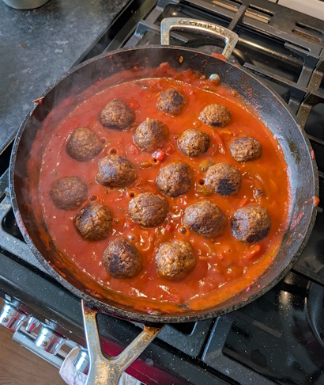

After that it was a simple matter of loading up my sub with my meatballs and sauce, then grating a bit of cheddar over the top and finishing off under the grill to get it nice and toasty.

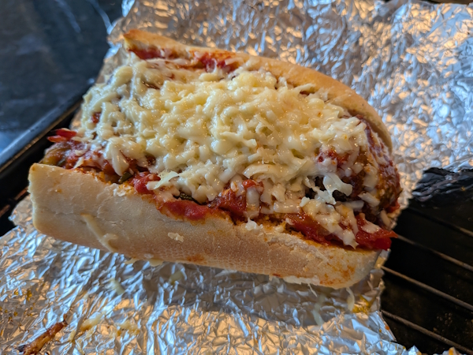

# August 28th: Mac and cheese at Gloucester services

It had been a stressful week due to my grandfather passing away and some uncertainty at work, so I was looking forward to being able to get away from it all for a week. The plan was to drive down to Bideford after work on the Friday, so that we could get the ferry across to Lundy island Saturday morning where we'd be staying for a week.

It's a fairly long drive, Manchester to Bideford, almost 5 hours. It does mean you get to stop off in the greatest of all service stations, Gloucester Services, the middle-class Cotswold fever dream where you can accidentally remortgage your house for artisanal chutney, a novelty butter dish and a chocolate cruffin.

I had a mac and cheese, with some salads on the side. I was mostly just after something comforting but again writing this up I realise I've not been eating particularly healthily. Burgers, meatball subs, mac and cheese. The broccoli does a little to assuage my guilt.

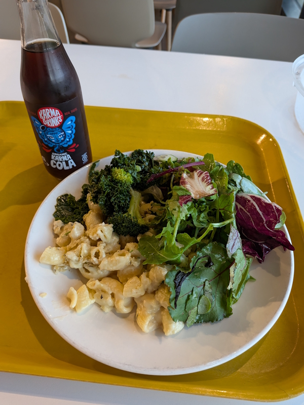

We made it to where we were staying quite late, but otherwise all fine. There was a bit of drama as there had been a dust up in the hotel just before we arrived, so we had to wait while the receptionist tried to sort it all out, and get an ice pack for the owner who was bleeding from a punch to the nose.

# August 28th: Chilli nachos and cinnamon bun cheesecake

It was an early start to get the ferry to Lundy island. It only runs every 2 or 3 days, so we'd be a little stuffed if we missed it. It was touch and go whether it would actually run at all, as it can get called off if the waters are too choppy, in which case you've got to wait for it to calm down or get a helicopter.

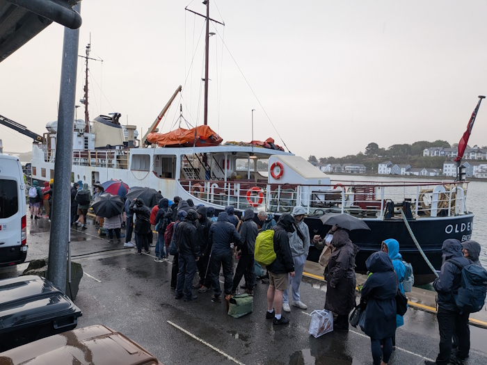

It's a 2 hour boat ride, and probably not great for those who get easily seasick. It was quite choppy when we went, but I imagine it's not so bad if you go earlier in the year. Once we landed they take your bag up to your house for you, so we had nothing to do until then but go for a quick stroll around the island.

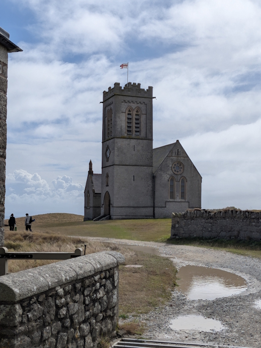 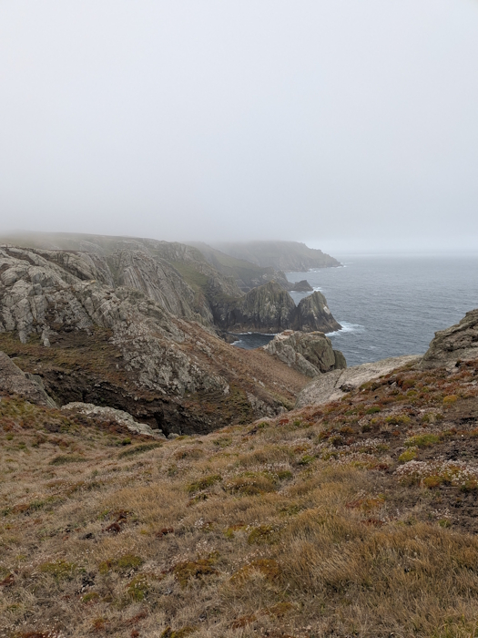 

There's two options for food on the island. The cottage we were staying in had a kitchen, and you could order ingredients for when you arrived or buy them from the local store and cook yourself a meal; or you could go for a meal at the one pub on the island, the Tavern. The food they do is quite simple but hearty. For the first night I ordered the veggie chilli nachos, which came with a very generous dollop of guac and sour cream, and a dessert of a cinnamon bun cheesecake. The cake was incredibly rich, and was made all the more decadent with a scoop of clotted cream.

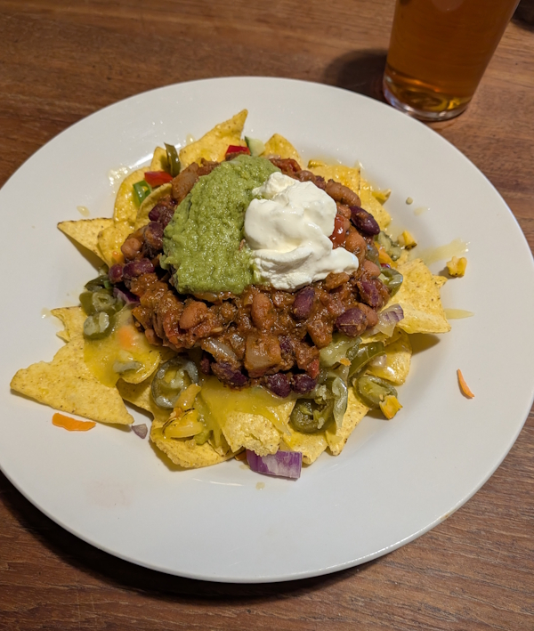 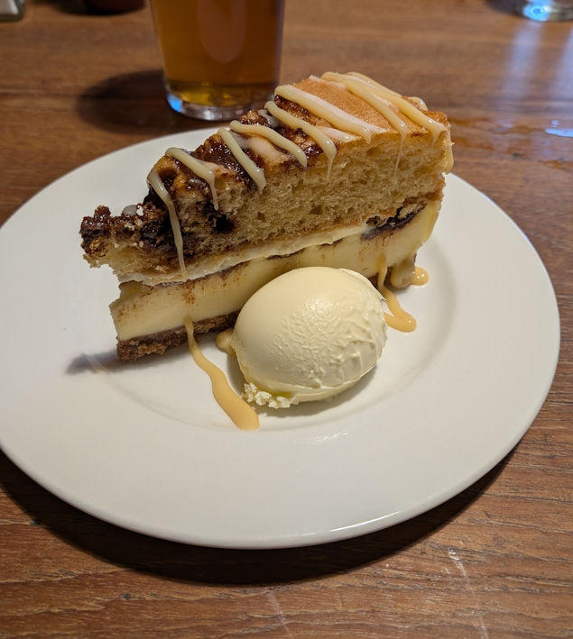

We'll eat at the tavern a few more times over the course of the next week, so I'll describe it more then. Got to leave something for the reader to look forward to. 